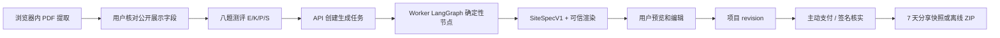

# BuildURProfile Agent 架构与仓库重构

日期：2026-10-30。本文是目标架构和迁移依据；未完成的阶段不代表现有代码已经具备该能力。

## 已确定的方向

- 第一版沿用 `PROJECT.md` 的固定 Marquee + StackedCards 骨架、八题测评和三套皮肤，生成可预览、可编辑、可导出的 HTML 网站。**不提供自然语言风格输入框，也不调用模型。**
- 采用 `apps/web`、`apps/api`、`apps/worker` 与共享 `packages/*` 的分层。生成任务由 LangGraph.js 组织为显式节点；支付和发布保持确定性的服务端业务逻辑。
- PDF 字节与原始解析结果留在浏览器；用户确认后，只有展示所需的公开副本可进入任务和服务端。付款与正式发布仍是独立的主动操作。
- 后续目标是支持生成任意 HTML 模板。该目标单列为第二阶段，届时需重新评估 `PROJECT.md` 的固定骨架限制，并增加隔离代码生成、构建和安全验收流程。

## 当前发布形态与目标架构的关系

2026-10-30 新增的 GitHub Pages 发布只托管 `apps/web` 的静态预览构建。它让用户体验浏览器内的 PDF → 确认 → 测评 → 固定骨架预览；`pages` 模式不请求 API、不保存项目，也不显示付费分享或 ZIP 入口。该发布不包含 `apps/api`，更没有接入 `apps/worker`、LangGraph 或模型节点。完整范围与发布检查见 `GITHUB_PAGES.md`，已核实的工作流状态见 `AGENTS.md`。

恢复服务端能力时，Web 与 API 需有可访问的同源路由或明确的跨域配置；API 运行在支持 Node 24 的服务环境，SQLite 数据库和匿名会话密钥必须在持久存储上。单实例可延续现有 SQLite 方案；增加多实例或独立 worker 前，须先设计共享数据库、任务领取与持久 checkpoint。GitHub Pages 的前端自动发布不能代替这些运行条件。

## 为什么 LangGraph 不必强制调用模型

LangGraph 管理状态、分支、暂停、重试和恢复。一个节点可以是普通 TypeScript 函数、外部工具调用，也可以是模型调用。浏览器 PDF 提取和用户确认位于服务端图工作流之前；付款核实与正式发布属于独立业务流程。当前的 PDF 文本提取、规则分段、8 题评分、`styleToConfig` 映射、schema 校验、可信组件渲染、付款核实和 ZIP 导出均有确定性实现，不因采用 LangGraph 而自动需要模型。

第一版的默认路径应在没有模型服务时仍能完成“PDF → 确认 → DesignConfig → HTML 预览”。模型只用于有明确非确定性输入的分支：

| 步骤或节点 | 输入 | 模型是否必要 | 预期输出 |
| --- | --- | --- | --- |
| 浏览器预处理：`extractResume` | 浏览器中的 PDF | 否；继续使用 PDF.js 与解析规则 | `ResumeDraft`，附原文出处 |
| 浏览器确认：`confirmContent` | 草稿与用户修改 | 否；用户确认后创建生成任务 | `ConfirmedContent` |
| `scoreStyle` | 职业与 8 题答案 | 否 | E/K/P/S、基础 `DesignConfig` |
| `retrieveDesignReferences` | 风格标签或检索词 | 否；可直接调用 MotionSites MCP | 带来源 ID 的候选参考 |
| `interpretDesignIntent` | 用户自由描述或参考图 | 可选；只有此类输入出现才调用 | 受 schema 约束的 `DesignBrief` |
| `adaptDesignRecipe` | 设计参考、风格偏好、允许的组件参数 | 可选；规则映射不足时调用 | 受 schema 约束的 `SiteSpec` 候选 |
| `validateAndRender` | `SiteSpec` 与确认内容 | 否 | HTML 预览与 ZIP 候选 |
| `verifyArtifact` | 生成物与验收规则 | 否；先用浏览器与程序检查 | 检查结果、可恢复错误 |
| 独立交付流程：`publish` | 用户主动请求与已验证资格 | 否；不作为设计 Agent 的自由工具 | 分享或 ZIP 交付 |

模型节点不得接收 PDF 原文、姓名、邮箱或项目详情，除非未来的产品设计明确改变这一隐私合同并得到用户确认。模型输出是设计数据，不是可执行的 React、HTML、CSS 或 JS。校验失败时使用现有确定性映射。MotionSites 提示词和第三方 skills 属外部参考材料，不能代替项目权限、schema 或构建验收。

## 方案权衡

1. **只用现有规则与 LangGraph：** 最小风险，可先完成架构迁移、任务状态和可恢复交付；设计多样性受现有参数限制。适合作为第一条可运行基线。
2. **LangGraph 加按需模型节点（推荐演进）：** 自然语言风格要求、参考图或多个设计参考的适配有更大空间；增加成本、延迟和不确定性，因此输出必须受 `SiteSpec` schema 与视觉验收约束。
3. **自由代码生成 Agent：** 能接近任意模板目标，但改变第一版固定骨架合同，需要独立沙箱、依赖白名单、离线构建、视觉及安全验收。留到第二阶段。

## 仓库分层与依赖方向

```text
apps/
  web/                 React/Vite 页面、浏览器 PDF、确认、测评、编辑、预览、离线入口
  api/                 Node HTTP、会话/CSRF、项目、支付宝、资格、发布、ZIP
  worker/              LangGraph 生成图、任务领取、检查点与外部设计参考适配器（待接入）
packages/
  contracts/           DesignConfig、SiteSpec、任务/API 合同及运行时 schema
  design/              纯函数评分、token、固定骨架映射（第二批迁移）
  renderer/            网页与离线导出共享的可信渲染器（第二批迁移）
scripts/               端到端/离线验收脚本
```

允许的依赖是 `web → contracts/design/renderer`、`api → contracts/renderer`、`worker → contracts/design/renderer`。支付和项目归属只能由 API 写入；worker 不接触支付密钥，不直接发放资格或分享 token。第一轮继续使用根 `package.json`，避免路径迁移和工作区依赖变更叠加；稳定后再评估 npm workspaces。前端保留 React/Vite/TypeScript，API 暂保留 Node 24 原生 HTTP/SQLite，生成图使用 LangGraph.js。Node API 在路由增长后再评估 Hono/Fastify，避免为分层而改动已验证的支付流程。

现有 `apps/web/src/App.tsx` 同时管理五个界面阶段、支付返回和项目状态，下一轮按 `intake`、`assessment`、`studio` 拆出；`apps/api/src/service.mjs` 的项目/订单/资格/交付也应按领域拆出。首轮只做可验证的物理分层和路径修正，不在一次修改中重写全部行为。`PROJECT.md` 是固定骨架的产品基线；本文件记录新增的 Agent 设计决策。

## 运行链路与边界



当前代码仍是浏览器本地 `styleToConfig` 直接生成配置；接入图以后，浏览器只提交已确认的展示字段、职业与分数。不得提交 PDF 字节、页级提取结果、原始全文或 `sourceRefs`。用户确认发生在图启动前，暂不使用 LangGraph `interrupt()` 重复实现。图产生候选预览，用户编辑形成新的项目 revision。正式交付与图分离，API 继续核验会话、CSRF、所有权、支付资格。付款事实只由支付宝签名通知或签名查单产生，不接受图或客户端自报。免费预览不授予正式分享和 ZIP。

## 第一版生成图合同

`GenerationRequestV1 = {requestId, schemaVersion: 1, role, styleVector, confirmedContent}`；`ownerSessionId` 由 API 会话注入，不接受客户端字段。图状态仅保留跨节点必需的请求 ID、版本、职业、风格向量、已确认公开内容、候选 `siteSpec`、验证结果和错误码。模型提示词、支付密钥、HTTP 原始请求和 PDF 不进入状态或 checkpoint。

```text
START → validateInput → scoreAndMap → buildSiteSpec
      → validateSiteSpec → renderPreview → verifyArtifact → END
```

`validateInput` 核对字段、长度和所属会话；`scoreAndMap` 沿用现有纯函数；`buildSiteSpec` 只允许 `templateId: "marquee-stacked-v1"`；`validateSiteSpec` 检查枚举、数值、图片/链接与无可执行代码；`renderPreview` 使用可信组件；`verifyArtifact` 检查可读性、键盘操作、降动效和离线资源。输出 `SiteSpecV1` 是结构化数据，不是任意 HTML/CSS/JS。每个节点可单测，图整体须和旧映射结果做黄金对比。LangGraph 节点可以是普通函数；checkpoint 在节点边界保存状态，[官方文档](https://docs.langchain.com/oss/javascript/langgraph/thinking-in-langgraph) 对此有说明。

任务 API 规划为 `POST /api/generations` → `202 {id,status}`、`GET /api/generations/:id` → 所属会话可读的状态/诊断/结果、`POST /api/generations/:id/retry` → 可重试失败。`(owner_session_id,idempotency_key)` 唯一约束阻止重复任务；任务带 `schema_version`、`attempt`、`lease_until`、时间戳。worker 租约领取并心跳，按有限次数退避重试；checkpoint 必须持久化，生产环境不能使用纯内存 checkpointer。首个单机实现使用 [LangGraph SQLite checkpointer](https://www.npmjs.com/package/@langchain/langgraph-checkpoint-sqlite) 和稳定的 `thread_id = generation.id`，任务表与 checkpoint 分离。API 创建任务后立即返回，worker 独立进程领取；worker TypeScript 用单独 tsconfig 编译为 Node ESM，再由 Node 24 运行。输入错误直接反馈，基础设施错误重试，非法生成物回退确定性配方或让用户编辑，未知代码错误记录并停止。旧任务不得覆盖新项目 revision。单机先用 SQLite；多实例部署前需迁移适合并发领取的队列/数据库。

## MotionSites、skills 与未来模型

第一版不需要模型节点。只有自由描述、参考图或多个参考的非确定性取舍进入产品时，才增加 `interpretDesignIntent` / `adaptDesignRecipe` 节点。模型只看精简设计意图和允许的 token/组件参数，返回受 schema 约束的设计数据；不得传姓名、邮箱、履历或 PDF。输出无效时回退已有规则配方。

MotionSites MCP 与 GitHub skills 放在 `worker/adapters` 的受限设计参考层，不是可自由访问项目/支付系统的工具。每条参考保存来源 ID、版本或获取时间、许可证、摘要、适用组件参数和内容哈希；设置超时、缓存、速率限制和允许来源。外部 prompt 是不可信材料，只能提炼为 `SiteSpec` 允许的 recipe，不能覆盖系统指令。GitHub skill 需先审查来源、许可、依赖、网络与代码执行范围，固定版本后注册成内部 recipe。参考服务不可用时，固定骨架仍能生成。

任意 HTML 模板目标单列 V2：引入新 `templateId`/`SiteSpecV2`，在隔离沙箱运行代码生成与构建，限定依赖、网络、CPU/内存/时间；再做 CSP、静态分析、浏览器视觉/交互检查和人工预览。旧项目继续按 V1 合同读取；任意代码不可塞进 V1 `DesignConfig`，也不能绕开付款和项目归属。

## 数据与安全合同

- `DesignConfig` 是现有网页与 ZIP 合同；首轮迁移字段保持兼容。后续 `SiteSpecV1` 须带 schema/template 版本，并经服务端运行时 schema 校验。当前 `apps/api/src/service.mjs` 只有部分白名单与范围检查，严格 schema 是第二批工作。
- 项目 `revision` 表示编辑版本；分享使用不可变 `config_json` 快照。当前下载 token 存 revision 却读取最新配置，应在服务端后续修正为快照绑定。
- `data/`、`.env`、`.alipay-sandbox.json` 保持私有；沙箱文件权限 `0600`，生产和沙箱分库分密钥。日志只记录任务 ID、节点、时长、错误码，不记录用户内容或密钥。checkpoint 与任务输入需配置保留期和清理。
- 匿名会话、CSRF、项目所有权、已核实支付资格、分享过期/撤销与 ZIP 权限都留在 API。沙箱实付及生产回调验收仍按 `AGENTS.md`，自动化测试不等于真实付款。

## 迁移步骤与验收

1. **本次开始：物理分层。** 建立 `apps/web`、`apps/api`、`packages/contracts`，修改 Vite/TypeScript/npm/服务端根路径；保持页面、API 和支付行为。公开 demo 配置移到可跟踪目录，自动化测试改用合成 fixture；真实简历 fixture 继续私有，不得意外提交。
2. **领域与合同。** 拆 `App`、`service`，抽纯函数和 renderer；加入共享运行时 schema，替换宽松字段检查。此时解决下载 token 的 revision 快照问题。
3. **任务和生成图。** 实现 `apps/worker`、持久任务/检查点和确定性 LangGraph；前端切换为异步状态、可恢复重试；验证重复请求、断线、重启和并发编辑。
4. **设计参考扩展。** 按受限适配器接入 MotionSites recipe/skill 注册表，再按用户输入需求决定是否加入模型节点。
5. **任意模板 V2。** 独立设计隔离执行与安全/视觉验收，保持旧分享快照只读兼容。

每一步都运行 `npm run build`、`npm test`、`npm run test:payment`、`npm run verify:export`；人工抽查 PDF 无上传、未付费交付被拒和支付签名查单。自动化样例已合成化，原来针对两份真实简历的特殊版式覆盖仍须用本机私有 PDF 单独回归，不能把这些文件提交。第一阶段代码迁移后的实际状态以 `REFACTOR_PLAN.md` 与测试输出为准。
