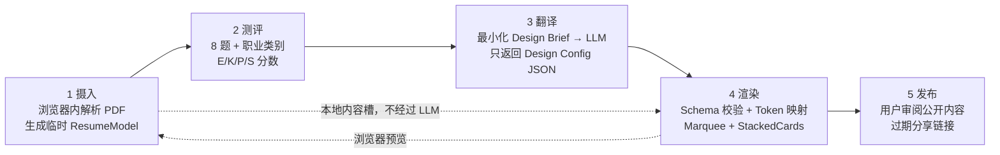

# 简历 → 交互式 Showcase：MVP 架构与 MCP 检索

**阶段：** Phase 0（设计文档，2026-10-26）  
**目标：** 让 UI/UX 设计师、前端/创意开发、品牌/动效/文案这三类用户，从文本型 PDF 简历得到可预览、可主动发布的桌面端 Showcase。产品签名始终是 **Marquee + StackedCards**；个性化只能调参数和 Design Tokens，不能改骨架。

**实现进度（PDF → 配置切片，2026-10-26）：** 已实现配置类型、两种骨架组件、三套 CSS 变量皮肤，以及浏览器内的文本型 PDF 提取、必经的字段确认表单、8 题测评、确定性 `styleToConfig` 映射、JSON 下载和本地预览。真实分享发布、扫描件 OCR 与 LLM 调用尚未接入。下文五层架构仍是完整产品规划，部分 Phase 1 表述保留为原始规划记录；当前可运行范围以此进度说明和 README 为准。

## 1. 五层架构

| 层 | 输入 → 输出 | 边界与职责 |
| --- | --- | --- |
| 摄入 | PDF → `ResumeModel` | 仅在浏览器内存解析与结构化；抽取姓名、简介、经历、项目、技能的候选字段供用户核对。原 PDF、全文及解析中间结果不上传、不持久化；关闭页面即清除。Phase 1 只处理可提取文本的 PDF。 |
| 测评 | 8 题 + 三选一职业 → `AssessmentScores` | E、K、P、S 均归一化到 `[0,1]`。E=视觉/语气表现程度，K=动效强度，P=视觉基调编码，S=线性浏览到用户可操控的倾向。P 同时保留四选一的 `PChoice`，避免把类别误当成连续色相插值。D 与 C 为锁定的内部预设，MVP 无题目、无控件、无配置输出。 |
| 翻译 | `{role, scores, selectedSkin}` → `DesignConfig` JSON | 只向 LLM 发送职业类别、测评分数及皮肤选择；不发送 PDF 文本、姓名、邮箱、项目描述或 `ResumeModel`。服务端只代理配置生成。模型仅能选预定义枚举与数值范围；校验失败使用确定性的本地预设。 |
| 渲染 | `DesignConfig` + 本地内容槽 → React 页面 | React + TypeScript + Vite + Tailwind CSS；固定 Marquee 与 StackedCards。先做运行时白名单/schema 校验，再映射 Token 与组件参数。文案作为文本节点渲染，不接收 LLM HTML、CSS、JS 或 React 代码。动效使用 CSS transition 与轻量 hook。 |
| 发布 | 用户确认的 `PublishableShowcase` → 带有效期链接 | 发布是独立的主动操作：显示即将公开的字段和媒体，用户可删改；仅上传这份明确确认的公开展示内容及已校验 Design Config，不上传 PDF、`ResumeModel` 或解析中间结果。默认 7 天到期，服务端按到期时间拒绝读取并清理数据；随机不可猜测的链接 ID，可提前撤销。 |

**数据合同：** `ResumeModel` 只存在于浏览器会话；`AssessmentScores` 是四个连续数值加 `PChoice`；`DesignConfig` 是翻译层唯一输出；`PublishableShowcase` 是用户审阅后的公开副本。发布层保存的不是浏览器内的 PDF 解析结果。若没有后端，Phase 1 的本地预览仍可工作，但真实的可撤销、强制过期分享必须由后端实施，不能只靠 URL 中的过期参数。

### 测评与配置映射草案

- 8 题按 E、K、P、S 各 2 题分配。E/K/S 用五档偏好题归一化取均值；P 用一题选四种基调、一题标注偏好强度，输出 `[0,1]` 的 P 及原始四选一 `PChoice`。四种 P 基调暂定为冷色、中性、暖色、高彩；它们是离散语义标签，连续值只供规则调节，不用于跨类别颜色插值。
- 皮肤是三套产品视觉方案，可由用户切换，翻译层可以推荐默认皮肤；P 是该皮肤内部的色彩倾向。两者不可混为同一个选项。E 调字重、字距与文案语气预设；K 调速度/时长；S 调自动推进与显式操控的权重。所有映射都要限制在参数范围内。
- 组件读取的姓名、技能、项目等内容来自本地内容槽；LLM 配置只控制表现形式。数值出界、枚举无效、缺字段或未知 `version` 时拒绝该配置并回退到本地预设。

## 2. 固定骨架的参数合同

当前渲染切片的 TypeScript 合同在 [`types/config.ts`](types/config.ts)。`DesignConfig` 的五个顶层字段为 `styleVector`、`skin`、`marquee`、`stackedCards`、`content`。`content` 是三板块 mock Resume JSON；组件从其中接收 `items` 和 `cards`，避免在配置中复制内容。下表以当前请求为准，Phase 0 提议的其他参数留待后续版本。

| Marquee 参数 | 建议范围/枚举 | 作用 |
| --- | --- | --- |
| `direction` | `left / right` | 流动方向 |
| `speed` | 正数，像素/秒 | 自动流速；修改 `config.json` 即改变周期 |
| `bindToScroll` | 布尔 | 用滚动位置驱动位移，替代自动循环 |
| `rows` | 1–4 | 跑马灯行数 |
| `tileSize` | 像素值 | 单个词条的宽度 |
| `pauseOnHover` | 布尔 | 鼠标悬停暂停 |
| `items` | 字符串数组，组件输入 | 从 `content.expertise.skills` 取得词条 |

| StackedCards 参数 | 建议范围/枚举 | 作用 |
| --- | --- | --- |
| `scaleStep` | 建议 0–0.2 | 每层缩放差 |
| `offsetStep` | 像素值 | 每层垂直错位距离 |
| `stickyTop` | 像素值 | 桌面滚动时顶部固定位置 |
| `layout` | `center / offset / fan` | 同一堆叠骨架的横向与旋转排布 |
| `cardRadius` | 像素值 | 卡片圆角 |
| `enableTilt` | 布尔 | 启用非触屏指针倾斜反馈 |
| `cards` | 项目数组，组件输入 | 从 `content.projects` 取得卡片 |

动效必须遵守 `prefers-reduced-motion`：减速或停止自动循环，卡片保留可点击/键盘访问。Phase 1 代码中保留一行触屏降级注释：`// Touch: disable hover-only behavior and expose tap controls for card navigation.` 桌面网页是唯一设计断点，不制作移动版布局。

## 3. MotionSites MCP 检索记录

Phase 0 按要求只调用了两次 `search_prompts`，每次 `limit: 8`：

1. `marquee scroll gallery sections`（目标关键词：`marquee`, `scroll`, `gallery`）
2. `stacked cards sticky scroll sections`（目标关键词：`stacked`, `cards`, `sticky`, `scroll`）

**接口差异：** 当前 `search_prompts` 只接受 `query` 与 `limit`，无法传入 `keywords` 数组或 `kind: "sections"`；返回项的 `kind` 均为 `website`，也没有 `hasCode`、`slug` 或 `tier` 字段，只有 `id`、`category`、`access` 等元数据。因此按“只取 `hasCode: true`”的硬筛选，**已验证可收录清单为 0 条**。不能将 `id` 伪称为 `slug`，或将 `access` 伪称为 `tier`。

下表只是**未入选的检索线索**，供 Phase 1 在能取得 `hasCode`、`slug`、`tier` 的元数据接口后复核；推荐理由仅依据标题和分类，不代表已读过提示词或验证过代码。

| 检索批次 | 返回 ID（待验证 slug） | category | 返回 access（非 tier） | 推荐复核理由 | 入选状态 |
| --- | --- | --- | --- | --- | --- |
| Marquee | `scroll-marquee` | Marquee | premium | 标题与固定跑马灯骨架直接对应，可复核速度与滚动触发的参数思路 | 未验证 `hasCode`，不入选 |
| Marquee | `rare-gallery` | Curated | free | 可复核项目媒体编排与画廊节奏是否适合内容槽 | 未验证 `hasCode`，不入选 |
| Marquee | `scroll-landing` | Interactive | premium | 可复核滚动驱动区段与页面叙事的连接方式 | 未验证 `hasCode`，不入选 |
| StackedCards | `nimbus-sticky-cards` | Cards | premium | 标题同时指向 sticky 与 cards，最接近固定堆叠卡片结构 | 未验证 `hasCode`，不入选 |
| StackedCards | `veloce-cards` | Cards | premium | 可复核卡片层级和过渡节奏 | 未验证 `hasCode`，不入选 |
| StackedCards | `media-card-carousel` | Slider | premium | 可复核显式切换控制，但需确认是否适合堆叠而非轮播 | 未验证 `hasCode`，不入选 |

未调用 `get_vault_prompt`、`get_prompt` 或其他 MotionSites 工具，也未获取任何提示词正文。检索结果附带的服务提示原文：Access ALL prompts for stunning animated websites in one click: https://motionsites.ai/unlimited

## 4. 三套皮肤的 Design Token 草案

三套皮肤共享相同骨架和 Token 键。`PChoice` 只调整 accent 色系及少量表面色，不改变结构或创建第四套皮肤。字体先用系统/开源字体栈，避免 demo 对付费字体的依赖。

| Token | 深色科技 `dark-tech` | 亮色极简 `light-minimal` | 高饱和 `high-saturation` |
| --- | --- | --- | --- |
| 背景 / 表面 | `#080D18` / `#111B2C` | `#F8F8F5` / `#FFFFFF` | `#171024` / `#2B1743` |
| 主文字 / 次文字 | `#F1F6FF` / `#A7B6CA` | `#16191D` / `#667078` | `#FFF8E9` / `#D8C5E9` |
| 强调色 / 描边 | `#4DE0D2` / `#2B4354` | `#2457FF` / `#D9DEE4` | `#FF5C35` / `#8F56E8` |
| 字体 | 标题 `Space Grotesk, Inter, sans-serif`；正文 `Inter, sans-serif` | 标题/正文 `Inter, system-ui, sans-serif` | 标题 `Space Grotesk, system-ui, sans-serif`；正文 `Inter, sans-serif` |
| 圆角 | 卡片 `16px`；按钮 `8px` | 卡片 `8px`；按钮 `6px` | 卡片 `24px`；按钮 `12px` |
| 阴影 | `0 20px 60px #0008` + 细亮边 | `0 12px 32px #17212B1A` | `0 20px 48px #0A061080` + 彩色边 |

所有组合在 Phase 1 进行文字对比度与焦点可见性检查；不能让用户的 P 倾向覆盖可读性约束。

## 5. Phase 1 范围

### 只做

1. 桌面网页 demo：三类职业入口、文本型 PDF 本地摄入、字段核对、8 题测评、E/K/P/S 计算、三皮肤切换。
2. 受 schema 限制的 Design Config JSON 翻译通道、校验、失败回退；固定 Marquee + StackedCards 的参数化渲染；CSS transition + 轻量 hook 动效。
3. 本地预览与发布前字段审阅；用户主动发布后生成默认 7 天有效的链接，并支持过期拒绝访问与提前撤销。
4. 桌面键盘可访问、`prefers-reduced-motion`、触屏可点击降级，以及配置越界/非法内容的基本防护。

### 不做

1. 移动端适配、第四类职业、第四套皮肤、骨架自由组合、D/C 控件。
2. 由 LLM 输出 React/HTML/CSS/JS、上传 PDF 或解析结果给 LLM、自动发布、无期限分享链接。
3. UI 组件库（包括 shadcn、Radix）、Framer Motion、复杂时间轴或 3D 动效；`lucide-react` 仅在确有图标需要时考虑。
4. 扫描件 OCR、账号体系、CMS/协作编辑、作品站托管域名、访客分析。

**Phase 1 验收线：** 三种职业的样例 PDF 均能得到完整桌面预览；八题稳定产出四个 `[0,1]` 分数及 P 四选一；同一内容可切换三套皮肤但骨架始终不变；LLM 响应中没有可执行代码且非法配置会回退；网络请求中没有 PDF 或解析中间结果；未确认前不发布；发布链接默认 7 天到期且到期后服务端不可读取。
